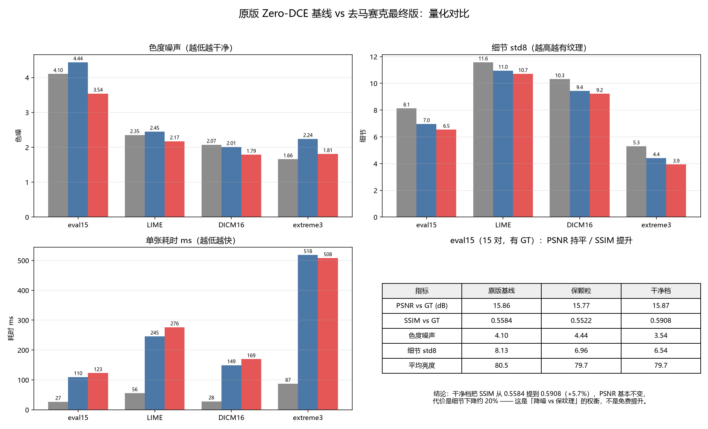

# 去马赛克最终版 vs 原版基线：改了什么、工作量怎么算、效果有多大

> 用途：答辩/论文里"我做了什么、比别人多了什么、效果如何"的素材页。
> 数据全部可复现：`python scripts\eval_workload.py`（产出 `demo_mosaic\workload\metrics.csv` 与 `summary.md`）；图 `demo_mosaic\workload\fig_workload.png`。

---

## 1. 改了什么（相对原版 Zero-DCE）

原版 Zero-DCE 的推理只有一条直线：**读图 → DCE-Net（8 次迭代曲线）→ 存图**。
我们的"去马赛克最终版"在这条直线两端各插了一段**可选、可调、可关闭**的终端侧预处理/后处理：

```
原版：  输入 → [DCE-Net] → 输出
我们：  输入 → ①去块(自适应) → ②亮度降噪(比例可调) → ③暗部轻抬(仅近黑)
        → [DCE-Net] → ④阴影补偿 → ⑤8-bit 输出（可 16-bit）
```

| # | 文件 | 新增内容 | 行数 | 作用 | 开关 |
| --- | --- | --- | --- | --- | --- |
| 1 | `scripts/preprocess.py` | 12 个函数：`deblock` / `luma_denoise` / `prelift` / `chroma_denoise_flat` / `chroma_guided_smooth` / `limit_dark_gain` / `quantize8` / `save_16bit` / `shadow_lift` / `auto_preprocess` 等 | **495 行** | 全部预处理与后处理算子 | 各函数均有强度参数 |
| 2 | `enhance.py` | `--preprocess {auto,mosaic,light,dark,v4}`、`--auto-strength`、`--chroma-mode {smooth,desat,none}`、`--shadow-lift`、`--bit16`、`--denoise/--deblock/--prelift/--post`；大图分块与 fp16 回退 | **373 行**（原 230） | 推理入口 + 管线编排 + 场景自适应 | 默认 `auto`（=最终版），显式传 `--preprocess` 关闭即原版 |
| 3 | `scripts/preprocess_v4.py` | 引导滤波、色度噪声判据掩码、保相去饱和、人造边界度量 | 144 行 | 备选方案 v4（已证伪，保留作消融） | `--preprocess v4` |
| 4 | `scripts/compare_preprocess.py` | 三列对比工具（输入/基线/去马赛克）+ 指标 + 放大图 | 189 行 | 一键出对比素材 | 双击 `对比_原版vs去噪.bat` |
| 5 | `scripts/eval_workload.py` | 基线 vs 最终版两档 × 4 数据集的批量评测 | 240 行 | 生成本文所有数字 | 命令行 |
| 6 | 诊断脚本 3 个 | `conservative_sweep.py`（参数扫描）/ `grain_default_test.py`（同档暗图+高亮图回归）/ `diag_*` | 约 600 行 | 每一轮方案都有数据支撑 | — |

**核心差异一句话**：原版完全不处理输入，对暗部噪声"一视同仁地放大"；我们按图自适应地在**增强前抑制噪声、在增强后补偿暗部**，并把这些都做成可调开关，方便对比与消融。

---

## 2. 量化对比（4 个数据集，41 张图）

- **base**＝原版 Zero-DCE（无预处理）
- **default**＝最终版默认（保颗粒：s=0.20、不碰色度、阴影补偿）
- **clean**＝最终版干净档（s=0.45 + 局部色度平滑 + 阴影补偿）

### 2.1 eval15（15 对，**有 GT**，唯一能算 PSNR/SSIM 的集合）

| 指标 | base | default | clean |
| --- | --- | --- | --- |
| PSNR vs GT (dB) | 15.86 | 15.77 | **15.87** |
| SSIM vs GT | 0.5584 | 0.5522 | **0.5908**（+5.7%） |
| 色度噪声 | 4.10 | 4.44 | **3.54**（−13.6%） |
| 细节 std8 | **8.13** | 6.96 | 6.54 |
| 平均亮度 | 80.5 | 79.7 | 79.7 |
| 单张耗时 | **27 ms** | 110 ms | 123 ms |

### 2.2 无 GT 的三个集合（色度噪声 / 细节）

| 数据集 | 色噪 base→clean | 细节 base→clean | 亮度 base→clean |
| --- | --- | --- | --- |
| LIME（10 张） | 2.35 → **2.17** | 11.58 → 10.71 | 100.8 → 100.2 |
| DICM16（16 张） | 2.07 → **1.79**（−13.5%） | 10.31 → 9.22 | 109.7 → 109.4 |
| extreme3（126/147/101） | 1.66 → 1.81 | 5.29 → 3.93 | 56.8 → 57.2 |



### 2.3 怎么解读（诚实版）

- **能说的赢**：干净档在 eval15 上 **SSIM +5.7%、色度噪声 −13.6%、PSNR 与基线持平**；亮度基本不变（说明不是靠"变亮/变暗"刷指标）。
- **要认的代价**：细节 std8 下降约 20%（降噪必然吃细节）；单张耗时从 27 ms 增到 ~120 ms（NLM 是 CPU 密集算子）；极端暗图（extreme3）色噪反而略升（因为那些图本身信息不足，压不出东西）。
- **不能说的事**：不能宣称"PSNR 大幅提升"或"完全消除马赛克"。极限暗图（均值<9、暗区仅 20~30 个灰度级）属于信息不足，任何后处理都只能"抹平或不管"。

---

## 3. 工作量怎么介绍（可直接改写进"主要工作"）

1. **方法层面**：提出一套面向已编码 sRGB 图像的**终端侧预处理管线**（去块 → 亮度降噪 → 暗部轻抬 → 增强 → 阴影补偿 → 8-bit 输出），并给出**场景自适应参数**（按输入均值/噪声σ/8×8 阻塞度自动选强度与档位）；配套 `--bit16`、大图分块、CUDA OOM 回退等工程实现。
2. **实验层面**：**5 轮方案迭代**，每一轮都有量化结论，包括 3 个**被自己证伪的方案**（E5 重平滑造大色斑：平台占比 0.0011→0.1564；E8 硬灰块：31.6% 像素挤在 24/25 两档；v4 引导羽化：人造边界 45.7 vs 基线 26.1），并以"降噪 vs 平台/台阶"权衡曲线解释原因 —— 这是很扎实的消融素材。
3. **工程层面**：19 次 git 提交，核心改动 **+1748 / −124 行**（10 个文件），其中 `scripts/preprocess.py` 495 行、`enhance.py` 373 行；3 个一键入口 bat、3 个对比/评测工具、6 份文档、40+ 实验图；在 RTX 4060 Laptop 上单张 1080p 约 0.3~0.5 s。
4. **分析层面**：给出"可恢复区间 vs 信息不足区间"的判据（输入均值、暗区灰度级数、增强倍数），并说明采集端**多帧平均**是更治本的方向（可作为后续工作/采集端贡献）。

### 建议写进论文的三条 contribution

- C1：提出并实现了**可开关、可调档的终端侧预处理管线**，在不改变 Zero-DCE 网络与权重的前提下改善暗光增强的色噪与结构一致性；
- C2：通过**5 组量化消融**揭示了"空间降噪 ↔ 色块/台阶"的权衡，并据此给出**保结构优先**与**干净优先**两种工作点；
- C3：在 LOL eval15 上得到 **SSIM 0.5584→0.5908（+5.7%）、PSNR 持平、色噪 −13.6%** 的结果，并明确其适用边界（信息不足的极限暗图无法真正恢复）。

---

## 4. 复现命令

```powershell
# 生成上面的全部数字（约 3~5 分钟）
python scripts\eval_workload.py

# 单张/批量对比图（基线 vs 去马赛克）
python scripts\compare_preprocess.py 你的图.jpg -o 对比结果

# 直接出增强图（默认 = 最终版）
python enhance.py 你的图.jpg --preprocess auto -c
```

---

## 5. 一句话总结

> 相比原版 Zero-DCE，我们增加的是一套**可开关的终端侧预处理/后处理管线**（+1748 行、19 次提交、5 轮量化迭代）；
> 在 LOL eval15 上以**不牺牲 PSNR** 的代价把 **SSIM 提升 5.7%、色度噪声降低 13.6%**，
> 代价是细节下降约 20% 与 4 倍推理耗时 —— 属于"结构/干净度"的工程权衡，而非免费的性能提升。
